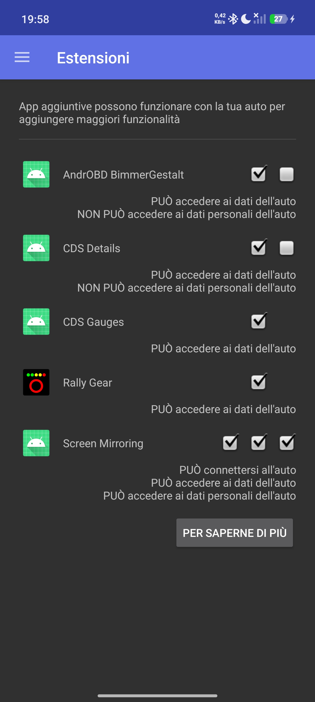
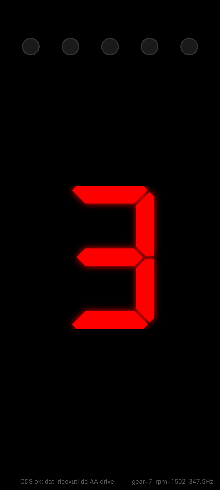
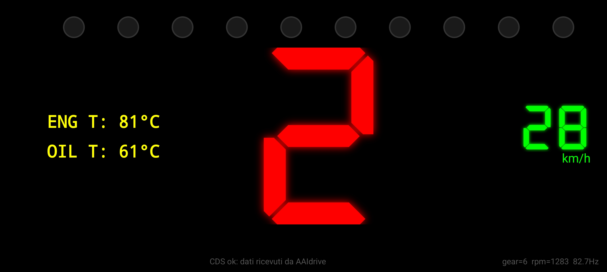

<div align="center">

# Rally Gear

**A rally-style dashboard for MINI and BMW: gear, shift lights, speed and temperatures on your Android phone.**


[](LICENSE)

<br>

🇬🇧 English · [🇮🇹 Italiano](README.it.md)

</div>

<p align="center">
  
  &nbsp;&nbsp;
    
  &nbsp;&nbsp;
  
</p>
---

## Overview

**Rally Gear** is an addon for [AAIdrive](https://github.com/BimmerGestalt/AAIdrive) that turns your smartphone into a gearbox indicator like the ones seen in rally cars. The original idea was to use only portrait mode as the gear indicator is a single digit display, however since we have the ability to rotate the smartphone screen, I have added a landscape mode with additional useful info on the sides.

- **Engaged gear** in a 7-segment font with a red glow;
- **Shift lights**: green → yellow → red LEDs driven by engine RPM;
- **Speed** (km/h or mph) with a green glow;
- **Engine and oil temperature**.

### CAN bus data over USB, no OBD dongle

The phone connects to the car **through a USB cable** via AAIdrive, which exposes the CDS (Car Data Service) values read directly from the car. Compared with a Bluetooth/Wi-Fi OBD-II dongle:

- **no dongle** to buy, pair or power;
- **low latency** and **high update rate**: data arrives in real time, on every change notified by AAIdrive (the actual RPM update rate is shown in the debug values, see below);
- a stable connection, and the phone keeps charging while in use.

## Features

| | |
|---|---|
| **Gear** | `N`, `R`, `P`, `0`, `1`, `2`, … in 7 segments, `-` when no data |
| **Shift lights** | 5 LEDs in portrait, 10 in landscape (lit in pairs), customizable thresholds |
| **Speed** | km/h or mph, your choice |
| **Temperatures** | `ENG T` (engine) and `OIL T` (oil), in °C |
| **Orientation** | 4 rotations (0°, 90°, 180°, 270°) set manually, to fit any phone mount |
| **Screen** | pure black `#000000`, always on, fullscreen |
| **Debug** | raw values and RPM update rate at the bottom right |
| **Languages** | English and Italian (follows the phone language) |

## Installation

1. Install **AAIdrive** (a recent version with the CDS content provider) and connect the phone to the car.
2. Install the Rally Gear APK from the [Releases](../../releases) section or from the repository artifacts. Install **AAIdrive first** so the CDS permission is granted automatically (otherwise reinstall Rally Gear).
3. Open AAIdrive and check that *Rally Gear* appears in the **Addons** tab.
4. Open Rally Gear and place the phone in its mount.

The status line at the bottom tells you whether data is arriving: AAIdrive unreachable, permission denied, or waiting for car data.

## Usage

The interface is controlled with **long presses** (without moving your finger), so there are no accidental touches while driving. The action depends on the zone you press:

| Zone | Press | Action |
|---|---|---|
| **LED band** (top of the screen) | 2 seconds | Opens the LED thresholds popup |
| **Speed** (landscape layout) | 2 seconds | Toggles between km/h and mph |
| **Anywhere else** | 3 seconds | Rotates the screen by 90° |

### Rotation

The app **does not follow the sensor**: it starts in portrait and changes orientation only manually, in sequence **0° → 90° → 180° → 270° → 0°**, with a vibration and a confirmation message. Your choice is remembered when the app is reopened. Portrait (0°, 180°) and landscape (90°, 270°) use two dedicated layouts:

- **Portrait:** 5 LEDs at the top, gear in the center.
- **Landscape:** 10 LEDs across the top edge, gear in the center, speed on the right, temperatures on the left.

### Speed unit

The car only provides speed in km/h; the app converts to mph (× 0.621371). Your choice is saved.

### Customizable shift lights

There are 5 thresholds, the same in portrait and landscape (where the 10 LEDs light up in pairs). Defaults:

| Threshold | Portrait LED | Landscape LEDs | Color |
|---|---|---|---|
| ≥ 3500 RPM | 1 | 1 and 2 | green |
| ≥ 4200 RPM | 2 | 3 and 4 | green |
| ≥ 5000 RPM | 3 | 5 and 6 | yellow |
| ≥ 5700 RPM | 4 | 7 and 8 | yellow |
| ≥ 6500 RPM | 5 | 9 and 10 | red |

Hold the LED band for 2 seconds to open the editing popup: the **−** and **+** buttons change the threshold in steps of 100 RPM (hold to repeat), changes are **applied and saved immediately**, and **Reset** restores the defaults. Thresholds always stay in ascending order.

## CDS data used

AAIdrive exposes CDS properties as an Android Content Provider (`content://io.bimmergestalt.cardata.provider/cds/<property>`).

| Property | Value | Use | Update |
|---|---|---|---|
| `driving.gear` | `{"gear": N}` | gear | real time |
| `engine.RPMSpeed` | `{"RPMSpeed": N}` | engine RPM → LEDs | real time |
| `driving.speedActual` | `{"speedActual": N}` (km/h) | speed | real time |
| `engine.temperature` | `{"temperature": {"engine": N, "oil": N}}` (°C) | ENG T / OIL T | every 10 seconds |

Temperatures change slowly and are re-read every 10 seconds, leaving all the bandwidth to the fast data. The displayed gear is `value − 4` from 4 upwards (`4 → 0`, `5 → 1`, …), while `1 = N`, `2 = R`, `3 = P`.

The **Hz** value in the debug data shows how many times per second the engine RPM value **changes** (moving average over 2 seconds): re-reads of the same value are not counted.

References: [CDS documentation](https://bimmergestalt.github.io/BMWConnectedAnalysis/cds/) · [IDriveConnectAddons](https://github.com/hufman/IDriveConnectAddons).

## Project structure

```
app/src/main/
├── java/…/rallygear/
│   ├── MainActivity.kt          UI, LEDs, long-press gestures
│   ├── MainModel.kt             ViewModel: gear, RPM, speed, temperatures, status
│   ├── CdsLiveData.kt           CDS data reading (real time or polling)
│   ├── ShiftLightSettings.kt    saved LED thresholds
│   ├── ThresholdsDialog.kt      threshold editing popup
│   ├── RateMeter.kt             Hz measurement
│   └── RallyGearService.kt      lets AAIdrive discover the addon
└── res/
    ├── layout/ , layout-land/   portrait and landscape layouts
    ├── values/strings.xml       English texts (default)
    ├── values-it/strings.xml    Italian texts
    └── values/dimens.xml        text sizes
```

## License

Distributed under the [MIT](LICENSE) license. The CDS content provider protocol is the one documented and implemented by [BimmerGestalt](https://github.com/BimmerGestalt) (also MIT).
